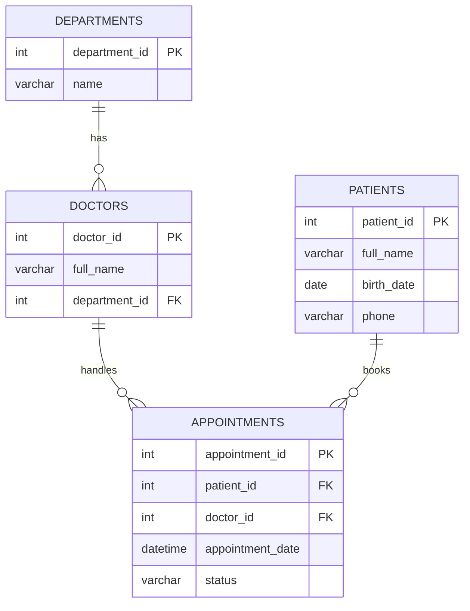

# Hospital Database (MySQL)

A relational database for managing hospital appointments, built with MySQL 8.0 and MySQL Workbench. The project covers table design, primary/foreign key relationships, sample data, and reporting queries.

## Database Design

## Tables

| Table | Description |
|---|---|
| `departments` | Hospital departments |
| `doctors` | Doctors and the department they belong to |
| `patients` | Patient records |
| `appointments` | Links patients to doctors with date and status |

## Project Files

| File | Purpose |
|---|---|
| `schema.sql` | Creates the database and tables |
| `data.sql` | Inserts fictional sample data |
| `queries.sql` | Reporting queries |

## How to Run

1. Open MySQL Workbench and connect to your local server.
2. Run `schema.sql`, then `data.sql`, then `queries.sql`.

## Sample Queries

- Appointments for a specific doctor (`WHERE`)
- Patient and doctor names per appointment (`JOIN`)
- Appointments count per department (`GROUP BY`)
- Patients with no appointments (`LEFT JOIN`)
- Appointments count by status (`GROUP BY`)

## Notes

All data in this project is fictional and used for demonstration only.

## Tools

MySQL 8.0, MySQL Workbench
